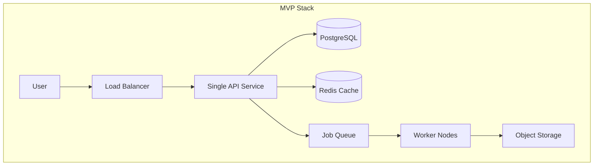
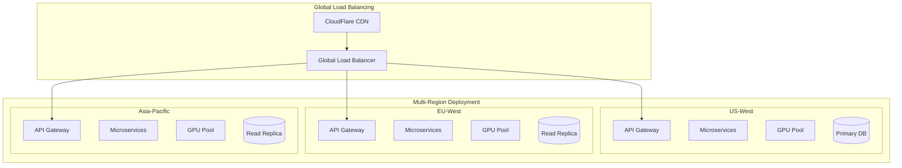

# MVP vs Production Roadmap

## Phase 1: MVP (Minimum Viable Product) - 3 months

### MVP Scope & Goals
- **Target:** 1k DAU, 100 concurrent generations
- **Features:** Basic image-to-video generation with single language
- **Focus:** Proof of concept, user validation, core functionality

### MVP Architecture



### MVP Components

#### 1. Simplified Backend Architecture
```yaml
# MVP Services:
- api-server: Combined auth + generation + user management
- worker-service: Single inference service
- postgresql: Single instance database
- redis: Single instance cache/queue
- nginx: Load balancer + static file serving
```

#### 2. MVP Tech Stack
- **Backend:** Python FastAPI (single service)
- **Database:** PostgreSQL (single instance)
- **Cache/Queue:** Redis (single instance) 
- **Storage:** AWS S3 or Google Cloud Storage
- **GPU:** Single GPU instance (V100 or T4)
- **Deployment:** Docker Compose or single Kubernetes cluster
- **Monitoring:** Basic logging + health checks

#### 3. MVP Database Schema
```sql
-- Simplified schema for MVP
users (
  id, email, password_hash, credits, tier, created_at
);

generations (
  id, user_id, image_url, prompt, video_url, 
  status, progress, created_at, completed_at
);

jobs (
  id, generation_id, status, payload, created_at
);
```

#### 4. MVP API Endpoints
```
POST /auth/login
GET  /auth/profile
POST /upload/image
POST /generate
GET  /generate/{id}
GET  /generations (list user's generations)
```

#### 5. MVP Features
- ✅ User registration/login (email/password only)
- ✅ Image upload (drag & drop)
- ✅ Text prompt input (English only)
- ✅ Basic video generation (5-10 seconds)
- ✅ Job status tracking
- ✅ Simple credit system (100 free credits)
- ✅ Basic web UI (React SPA)
- ❌ Multi-language support
- ❌ Real-time progress updates
- ❌ Advanced GPU scheduling
- ❌ Content moderation
- ❌ Public gallery

#### 6. MVP Success Metrics
- **Technical:** 95% uptime, <120s generation time
- **Business:** 500+ weekly active users, 70% completion rate
- **User:** >4.0 user satisfaction score

---

## Phase 2: Scale Foundation - 6 months

### Scale Goals
- **Target:** 10k DAU, 1k concurrent generations
- **Focus:** Performance optimization, reliability, basic enterprise features

### Key Enhancements

#### 1. Microservices Architecture
```yaml
# Phase 2 Services:
- auth-service: Dedicated authentication
- generation-service: Generation orchestration
- worker-service: GPU inference workers
- user-service: User management & credits
- notification-service: Email & push notifications
```

#### 2. Infrastructure Improvements
- **Database:** Master-slave PostgreSQL setup
- **Cache:** Redis cluster (3 nodes)
- **Queue:** Dedicated message queue (RabbitMQ/Redis)
- **Storage:** Multi-region object storage
- **GPU Pool:** 3-5 GPU instances with load balancing
- **Monitoring:** Prometheus + Grafana setup
- **Deployment:** Full Kubernetes cluster

#### 3. New Features
- ✅ Multi-language UI (English, Spanish, French)
- ✅ Real-time progress updates (WebSocket)
- ✅ Basic prompt translation
- ✅ Content safety filtering
- ✅ Advanced user tiers (Free, Pro, Premium)
- ✅ Public gallery (community features)
- ✅ Mobile app (React Native)
- ✅ API rate limiting
- ✅ Basic analytics dashboard

#### 4. Performance Targets
- **Uptime:** 99.5%
- **Generation Time:** P95 < 90s
- **Queue Wait Time:** P95 < 60s
- **API Response Time:** P95 < 500ms

---

## Phase 3: Production Scale - 12 months

### Production Goals
- **Target:** 100k DAU, 10k concurrent generations
- **Focus:** Enterprise features, global scale, AI optimization

### Production Architecture



### Production Features

#### 1. Advanced AI Pipeline
- **Models:** Multiple model versions (SVD, custom transformers)
- **Quality:** 4K video generation capability
- **Duration:** Up to 30-second videos
- **Customization:** Style transfer, camera controls
- **Batch Processing:** Efficient resource utilization

#### 2. Enterprise Features
- **SSO Integration:** SAML, OAuth2, LDAP
- **API Management:** Rate limiting, usage analytics, quotas
- **White-label:** Custom branding for enterprise clients
- **Compliance:** GDPR, SOC2, HIPAA compliance
- **SLA:** 99.9% uptime guarantee

#### 3. Advanced Multi-language Support
- **Languages:** 15+ supported languages
- **Localization:** Region-specific models and preferences
- **Cultural Adaptation:** Content moderation per region
- **Voice Integration:** Text-to-speech in multiple languages

#### 4. Intelligent Features
- **Smart Recommendations:** AI-powered prompt suggestions
- **Auto-enhancement:** Automatic prompt optimization
- **Quality Scoring:** AI-based output quality assessment
- **Trend Analysis:** Popular styles and effects

#### 5. Production Infrastructure
- **Auto-scaling:** Dynamic resource allocation
- **Multi-cloud:** AWS + GCP deployment
- **Edge Computing:** Regional inference nodes
- **Advanced Monitoring:** Full observability stack
- **Disaster Recovery:** Cross-region backup and failover

---

## Feature Comparison Matrix

| Feature | MVP | Scale Foundation | Production |
|---------|-----|------------------|------------|
| **Core Generation** |
| Image-to-Video | ✅ Basic (10s) | ✅ Enhanced (15s) | ✅ Advanced (30s, 4K) |
| Model Options | 1 (SVD) | 2-3 models | 5+ models |
| Quality Settings | Standard | Standard/High | Economy/Standard/Premium/4K |
| **User Experience** |
| Web App | ✅ Basic | ✅ Enhanced | ✅ Advanced |
| Mobile App | ❌ | ✅ Basic | ✅ Full-featured |
| Real-time Updates | ❌ | ✅ WebSocket | ✅ + Push notifications |
| **Languages** |
| UI Languages | 1 (English) | 3 (EN/ES/FR) | 15+ languages |
| Prompt Translation | ❌ | ✅ Basic | ✅ Advanced + Cultural |
| **Business Features** |
| User Tiers | Free only | Free/Pro/Premium | Free/Pro/Premium/Enterprise |
| Credit System | Basic | Advanced | Full billing + subscriptions |
| Public Gallery | ❌ | ✅ Basic | ✅ Social features |
| **Technical** |
| Database | Single PG | Master-Slave | Multi-region |
| Cache | Single Redis | Redis Cluster | Distributed cache |
| GPU Pool | 1 GPU | 3-5 GPUs | 50+ GPUs |
| Regions | 1 | 1-2 | 3+ |
| Monitoring | Basic logs | Prometheus/Grafana | Full observability |
| **Performance** |
| Uptime SLA | 95% | 99.5% | 99.9% |
| Generation Time | <120s | <90s | <60s |
| Concurrent Users | 100 | 1k | 10k |
| Daily Users | 1k | 10k | 100k |

---

## Implementation Timeline

### MVP Phase (Months 1-3)

**Month 1: Core Backend**
- [ ] Setup basic FastAPI application
- [ ] PostgreSQL + Redis setup
- [ ] User authentication system
- [ ] Image upload functionality
- [ ] Basic job queue system

**Month 2: AI Integration**
- [ ] Integrate Stable Video Diffusion
- [ ] GPU inference pipeline
- [ ] Job processing system
- [ ] Basic video generation
- [ ] Result storage & retrieval

**Month 3: Frontend + Testing**
- [ ] React frontend development
- [ ] API integration
- [ ] User testing & feedback
- [ ] Bug fixes & optimization
- [ ] MVP deployment

### Scale Foundation Phase (Months 4-9)

**Months 4-5: Microservices Split**
- [ ] Auth service separation
- [ ] Generation orchestrator service
- [ ] User management service
- [ ] Service-to-service communication
- [ ] API gateway implementation

**Months 6-7: Infrastructure Scale**
- [ ] Kubernetes deployment
- [ ] Database clustering
- [ ] Redis cluster setup
- [ ] Multi-GPU support
- [ ] Monitoring stack

**Months 8-9: Feature Enhancement**
- [ ] Multi-language UI
- [ ] Real-time updates
- [ ] Public gallery
- [ ] Mobile app development
- [ ] Performance optimization

### Production Phase (Months 10-15)

**Months 10-11: Global Infrastructure**
- [ ] Multi-region deployment
- [ ] CDN integration
- [ ] Database replication
- [ ] Global load balancing
- [ ] Edge computing setup

**Months 12-13: Advanced Features**
- [ ] Advanced AI pipeline
- [ ] Multiple model support
- [ ] Enterprise features
- [ ] Advanced analytics
- [ ] Compliance certification

**Months 14-15: Enterprise Readiness**
- [ ] SSO integration
- [ ] White-label platform
- [ ] Advanced monitoring
- [ ] SLA guarantees
- [ ] Production launch

---

## Risk Mitigation & Contingency Plans

### Technical Risks

#### 1. GPU Availability/Cost
**Risk:** GPU shortage or price increases
**Mitigation:**
- Multi-cloud strategy (AWS, GCP, Azure)
- Spot instance utilization
- Model optimization for lower-end GPUs
- Edge inference deployment

#### 2. Model Performance
**Risk:** Generated videos don't meet quality expectations
**Mitigation:**
- Multiple model options
- A/B testing framework
- User feedback integration
- Continuous model improvement

#### 3. Scaling Challenges
**Risk:** System can't handle user growth
**Mitigation:**
- Gradual rollout strategy
- Load testing at each phase
- Auto-scaling implementation
- Performance monitoring

### Business Risks

#### 1. Competition
**Risk:** Major players enter the market
**Mitigation:**
- Focus on specific niches
- Rapid feature development
- Strong user community
- API ecosystem

#### 2. Content Moderation
**Risk:** Inappropriate content generation
**Mitigation:**
- Multi-layer safety systems
- Human moderation team
- User reporting system
- Compliance with regulations

#### 3. Revenue Model
**Risk:** Difficulty monetizing free users
**Mitigation:**
- Freemium model with clear value proposition
- Enterprise sales strategy
- API licensing
- Marketplace commissions

---

## Success Metrics & KPIs

### MVP Success Criteria
- [ ] 500+ registered users
- [ ] 1000+ successful generations
- [ ] <5% error rate
- [ ] 70% user retention (7-day)
- [ ] Product-market fit validation

### Scale Foundation Success Criteria
- [ ] 5000+ monthly active users
- [ ] 99.5% uptime
- [ ] <90s generation time (P95)
- [ ] 50+ enterprise inquiries
- [ ] $10k+ MRR

### Production Success Criteria
- [ ] 50k+ monthly active users
- [ ] 99.9% uptime SLA
- [ ] <60s generation time (P95)
- [ ] $100k+ MRR
- [ ] 10+ enterprise customers

This roadmap provides a clear path from MVP to production-scale deployment, with specific milestones, risk mitigation strategies, and success metrics at each phase.
